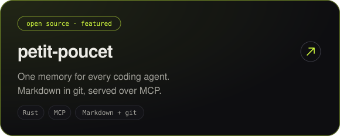
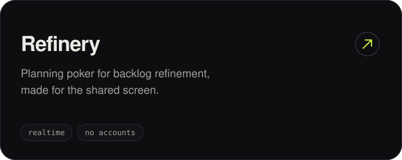
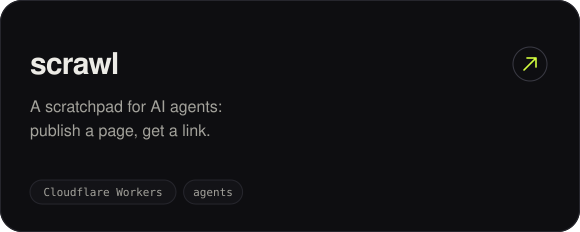
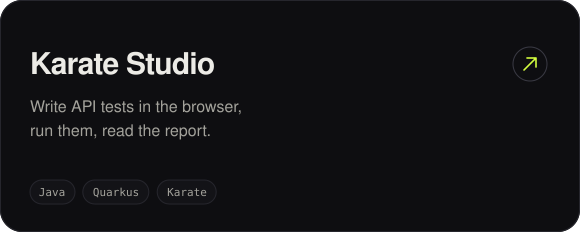

  
  

  Products that fix problems people actually have, 
  built with the right tool for each job. <i>Made for daily use, not for the demo.</i>

 

### `01` &nbsp;What I do

| | |
|---|---|
| **Agentic engineering** | Agents that do real work, whatever the harness: Claude Code, OpenCode, OMP, Pi, Copilot. MCP servers, skills, shared memory. |
| **Backends that hold up** | Java and Spring. Clean APIs, event-driven services, tested before trusted. |
| **DevOps, for real** | Continuous integration and delivery, containers, Kubernetes, cloud. Pipelines so boring nobody talks about them. |
| **Bringing the team along** | Coding dojos, pair and mob programming, AI fitted into the way a team already works. |

### `02` &nbsp;Selected work

  
  
  
  

### `03` &nbsp;Day job

Freelance since 2017, with Renault's digital teams since 2019. Very different products, same habits: tests first, automated pipelines, building blocks other teams can reuse.

> **Connected services** · **Vehicle engineering data** · **EV charging** · **Shared building blocks** · **Testing as a habit** · **AI, for everyone**

Lately: an agent that investigates production and keeps only the facts it can prove, and feedback that sorts itself into clear tickets.

### `04` &nbsp;The lab

Evenings and weekends, next to a full-time mission.

- *Tests that write themselves, and mend themselves when they break.*
- *Asking a Kubernetes cluster what hurts, and getting a straight answer.*
- *Coding agents on open-weight models, with no cloud in the loop.*
- *A car park full of make-believe chargers, talking to a real backend.*
- *The games of my childhood, rebuilt to find where vibe-coding breaks.*

### `05` &nbsp;Off the keyboard

Self-hosting, retro handhelds, and old cars that stay on the road.

 

  <i>"If you think good architecture is expensive, try bad architecture."</i> 
  <a href="https://areguig.github.io">areguig.github.io</a> · <a href="https://www.linkedin.com/in/areguig/">LinkedIn</a>

